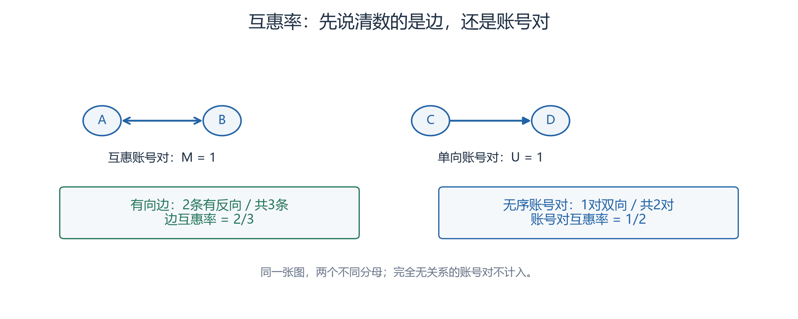

# 互惠性

互惠性衡量一对账号之间是否同时存在两个方向的关系。先说明数的是有向边、无序账号对还是加权事件，才知道这个比例的含义。本研究分别在主网络和直接回复网络计算互惠性，检查建边规则怎样影响结果。静态双向关系不要求同线程或先后顺序，因此还不能证明发生过有内容的往返。

## 同一张图，两个合理分母

令E为去重后的非自环有向边集合；M为互惠的无序账号对数；U为仅有单向边的无序账号对数。每个互惠对贡献两条有向边，所以 |E|=2M+U。

| 指标 | 公式 | 回答的问题 |
|---|---|---|
| 边互惠率 | r_edge=2M／(2M+U) | 随机选一条有向边，它有反向边的比例是多少？ |
| 账号对互惠率 | r_dyad=M／(M+U) | 随机选一对有关系的账号，它是双向的比例是多少？ |

A↔B加C→D时，M=1、U=1。有向边共3条，边互惠率为2/3；有关系的无序账号对共2对，账号对互惠率为1/2。两者没有矛盾。分母没有把完全无关系的账号对算进来。

*图：本组按本页虚构网络用Python绘制，CC BY 4.0；见[附件说明](../assets/core-concepts/README.md)。*

## 重复100次与回复1次不对称

本页选定加权口径：

r_weight=Σ(i≠j) min(w_ij,w_ji)／Σ(i≠j) w_ij。

求和遍历有序账号对，缺边的权重为0。若只有A→B的100次和B→A的1次，分子为1+1=2，分母为101，加权互惠为2/101；二值边互惠仍为1。它衡量两方向的事件量重叠，不是有多少条消息找到了真实回复。其他加权定义存在，报告时必须给公式。

没有边或总权重为0时，相应互惠率记“不可计算”，不要当作0。

## 本项目的解释边界

A在自己帖内回复B会被主网络去掉，却可能在直接回复网络形成A→B。因此两图的差异可能由定义直接造成。两图要分别报告窗口、过滤、自环、边数和公式，不能把较高的值直接解释成“更有社会性”。

即使B→A和A→B都存在，也可能分属两个月或两个线程。要确认有序往返，继续读[时间互惠](时间互惠.md)；要确认内容关联，另做[语义承接](语义承接.md)编码。

## 论文03的数字怎样核对

原文§5.4同时给出1,151,825个有向关系、18,855个“reciprocal”及3.3%。若18,855是无序互惠对，2×18,855／1,151,825≈3.27%，与3.3%相容；若是已计双向的有向边，直接相除约为1.64%。

**原数与文字已核实；18,855的计数单位及实现公式待核实。**不能把前一种解释写成作者已明确给出的定义。本项目直接从自身边表按明示公式计算，不照搬原文比例作基线。

## 来源与继续阅读

- **03**：Saber Zerhoudi等12人（2026），*Form Without Function: Agent Social Behavior in the Moltbook Network*，arXiv:2604.13052v1。[书目](https://arxiv.org/abs/2604.13052v1)／[全文](https://arxiv.org/html/2604.13052v1)。 §5.4原数及措辞已核；计数单位、实现公式待核实。两种二值公式及加权口径在本页明示，不冒充作者公式。

核对日期：2026-10-24；访问范围与限制见[本轮核验记录](../../notes/核心概念审读与文献核验-2026-10-24.md)。

**相关概念**：[网络边定义](网络边定义.md)、[时间互惠](时间互惠.md)、[度与强度](度与强度.md)。
