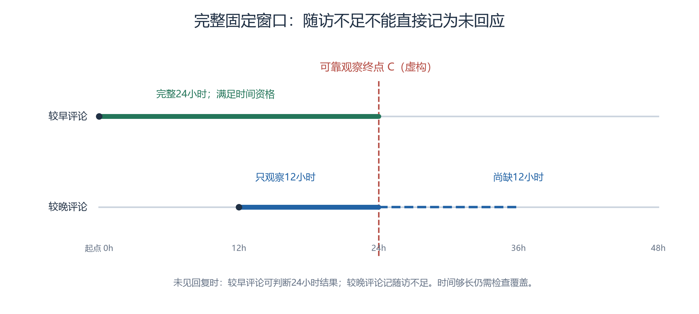

# 右删失

右删失指观察结束时还没有看到所关心事件，只知道它在已观察时间内没有发生。它不是“永远不发生”的标签。本研究关注评论何时得到直接回复或帖主回应，临近观察终点的评论往往没有完整等待机会。把它们全算作未回应，会使固定窗口的回应率受观察长短影响。

## 先定义事件，再定义观察终点

本页以“首次直接回复”为例；研究帖主回应时，事件必须改为首次帖主直接回复，不能拿其他人的回复充数。起始评论时间记t0，可靠观察终点记C，窗口长度记h。

一条评论10月7日09:00创建，可靠观察只到09:12；12分钟内未获回复，无法判断它24小时内是否会获回复。以下图例时间为虚构，不是对真实采集终点的认定。

*图：本组按虚构时间轴用Python绘制，CC BY 4.0；见[附件说明](../assets/core-concepts/README.md)。*

C必须有采集覆盖依据，不能仅取全表最大`created_at`，也不能直接把快照日期当成每帖均被观察到的时刻。当前计划暂用2026-10-07T00:00:00Z作保守截点，仍需核对各线程覆盖，并做截点前移检查。

## 主分析：完整固定窗口

资格条件是t0+h≤C，并且该窗口内的覆盖足以支持判断。主分析使用完整24小时或7天资格，不因已看到早期成功，就破例纳入随访不足的记录，以免成功和失败采用不同入组规则。

在合格记录中，0<回复时间−t0≤h算成功；未见合格回复才算该窗口内失败。窗口后才回复仍是可见回复，但不算窗口内成功。两种窗口分别列资格分母，不共用一个“未回复率”。

## 选读：保留不同随访的生存分析

若采用生存分析，可记录等待时间min(T,C−t0)及事件指示；T是首次目标回复距t0的时长，未见事件则在C删失。解释通常需要删失机制与事件时间在给定条件下足够独立等假设，不能靠公式消除选择性漏采。

论文L05有自身的风险集与两部分估计设计，不等同于本项目统一完整随访的主分析。本页固定24小时／7天是项目规则，不是该论文统一采用的窗口。

## 三种状态不能混在一起

| 状态 | 能否作固定窗未回应？ |
|---|---|
| 完整随访且覆盖合格，窗口内无目标回复 | 可以，结果仅限该窗口 |
| 窗口未满，尚未见目标回复 | 不可以，记随访不足 |
| 时间够长但漏采、缺父或覆盖不可靠 | 不可以，另列可观测性问题 |

只对获回复者平均等待时间，回答的是“已获回复者等多久”，不能代表全部评论。把未回复者等待时间填成无限大也不合适。正式报告同时给机会数、随访不足数、覆盖排除数；将截点前移1天、7天是敏感性检查，不能修复结构性漏采。

## 来源与继续阅读

- **L05**：Aysajan Eziz（2026），*Fast Response or Silence: Conversation Persistence in an AI-Agent Social Network*，arXiv:2602.07667v2。[书目](https://arxiv.org/abs/2602.07667v2)／[全文](https://arxiv.org/html/2602.07667v2)。 §3.3、5.2核对候选父评论、右删失、回应概率与条件等待；HTML标题将AI展开为Artificial Intelligence，书目沿用摘要页。

核对日期：2026-10-24；访问范围与限制见[本轮核验记录](../../notes/核心概念审读与文献核验-2026-10-24.md)。

**相关概念**：[数据快照与覆盖](数据快照与覆盖.md)、[帖主回楼](帖主回楼.md)、[生存分析](生存分析.md)。
