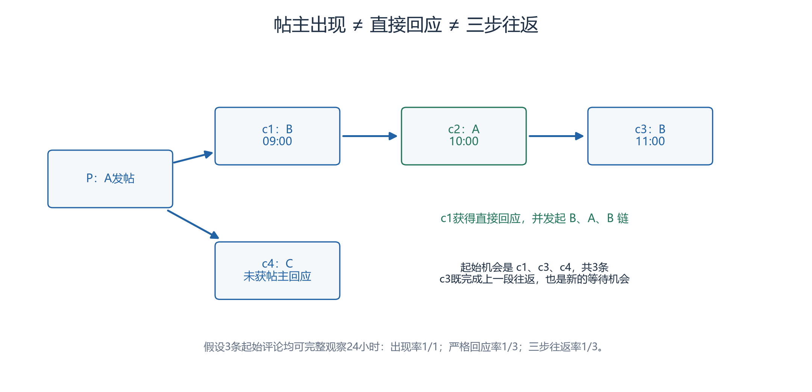

# 帖主回楼

帖主回楼指帖主在自己帖子下发表过评论。它只证明出现过，不能证明回应了某条非帖主评论。本研究将帖主出现、严格帖主回应和三步往返分开测量。三个指标先固定计数单位和观察窗口，才能判断回楼是否形成持续互动。

## 三个指标，两个计数单位

| 指标 | 成功条件 | 分母与计数单位 |
|---|---|---|
| 帖主出现率 | 帖主至少发过一条评论，不要求在别人之后 | 有可观测评论且帖主可识别的线程；每帖一次 |
| 24小时严格帖主回应率 | 帖主在起始非帖主评论后24小时内直接回复该评论 | 合格非帖主起始评论；每条一次 |
| 24小时三步往返率 | 帖主直接回应后，原评论者直接回复该回应；整条链在起始后24小时内完成 | 与严格回应完全相同的起始评论；每条一次 |

“合格”指账号可识别、父链可解析、同帖、时间顺序有效，符合预先冻结的过滤，并有完整24小时随访及覆盖依据。起始评论可以在任意层，不只取顶层或账号对的第一条。多次回应只让同一起始评论成功一次。

三步往返是严格回应的子集；在相同样本中，三步往返率不能超过严格回应率。条件于“已获回应”的再次回复率可以另报，但它换了分母，必须另命名。

## 一帖为什么会有三个机会（虚构）

A发帖。09:00 B评论c1；10:00 A直接回复c1成为c2；11:00 B直接回复c2成为c3。C另发c4，未获帖主回应。假设c1、c3、c4均合格且有完整24小时观察：

- 有评论线程1个，A出现，帖主出现率=1/1。
- 非帖主评论3条：c1、c3、c4。只有c1获帖主直接回应，严格回应率=1/3。
- 只有c1发起完整B、A、B链，三步往返率=1/3。

*图：本组按上述虚构事件用Python绘制，CC BY 4.0；箭头父→子，见[附件说明](../assets/core-concepts/README.md)。*

c3完成前一段往返，同时也是等待A后续回应的新机会，不能漏出分母。A的c2不进入非帖主机会分母。若A只是在别人来前补充说明，只能计出现；若A回的是C，不能记成对B的回应。

## 正式计算前保住机会

主网络去掉帖主在自己楼里的评论，但事件表不能先删这些评论，否则看不到c2。无评论帖子不进入出现率分母；时间不足记“随访不足”，缺父或覆盖不可靠另记原因，都不直接算失败。

出现率是快照内的宽松描述，没有固定24小时含义；不同帖龄比较它仍会受观察机会影响。两种24小时率都使用起始时间t0<回应时间≤t0+24小时，三步链最后一步也必须落在同一个总窗口，不能每一步各给24小时。

## 来源与继续阅读

- **03**：Saber Zerhoudi等12人（2026），*Form Without Function: Agent Social Behavior in the Moltbook Network*，arXiv:2604.13052v1。[书目](https://arxiv.org/abs/2604.13052v1)／[全文](https://arxiv.org/html/2604.13052v1)。 §5.2、表3提供帖主参与背景，不是严格直接回应率。
- **04**：Giordano De Marzo、Andres L. Marin、David Garcia（2026），*Collective Behavior of AI Agents: the Case of Moltbook*，arXiv:2602.09270v2（2026-10-07）。[书目](https://arxiv.org/abs/2602.09270v2)／[全文](https://arxiv.org/html/2602.09270v2)。 §2.4仅提供树结构背景。

核对日期：2026-10-24；访问范围与限制见[本轮核验记录](../../notes/核心概念审读与文献核验-2026-10-24.md)。

本页24小时总窗、资格及机会分母均是本项目定义。

**相关概念**：[回复树](回复树.md)、[右删失](右删失.md)、[时间互惠](时间互惠.md)。
