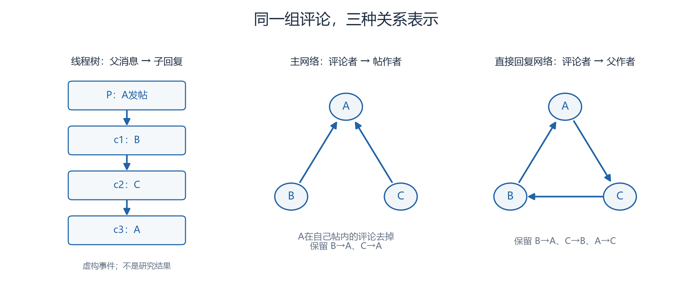

# 网络边定义

网络边定义是把行为记录转成节点之间关系的规则。同一条评论可以指向帖作者，也可以指向它实际回复的父消息作者。本研究保留两张账号图，用来检查“看起来互惠”是否依赖选了哪一种关系。先固定节点、方向、自环和时间窗口，网络指标才有明确含义。

## 三种对象与一张事件表

事件表一行对应一条评论，保留评论ID、帖子ID、父评论ID、评论作者、帖作者、父作者、时间与排除标记。先保留原事件，再按各图规则筛选，不能在这一步统一删除帖主评论。

| 对象 | 节点 | 一条边表示什么 | 自回复如何处理 |
|---|---|---|---|
| 主网络 | 账号 | 评论者→帖作者，不论评论嵌套在哪层 | 评论者等于帖作者时去掉 |
| 直接回复网络 | 账号 | 评论者→实际父作者；顶层父作者为帖作者 | 评论者等于实际父作者时去掉 |
| 线程树 | 帖子与评论消息 | 父消息→子回复，表示嵌套关系 | 保留同作者的父子消息 |

线程树的箭头与账号图用途不同：前者从父到子，后者从回复者指向对象。一个账号可以对应树中的多条消息。

## 同一段讨论的两张账号图（虚构）

A发帖P；B顶层评论c1；C回复c1成为c2；A回复c2成为c3。

| 事件 | 主网络 | 直接回复网络 |
|---|---|---|
| B的c1 | B→A | B→A |
| C的c2 | C→A | C→B |
| A的c3 | A→A，按规则去掉 | A→C，保留 |

*图：本组依据上表虚构事件用Python绘制，CC BY 4.0；树箭头父→子，账号图箭头评论者→对象。来源与授权见[附件说明](../assets/core-concepts/README.md)。*

若C在A的帖子里回复自己的c2，主网络仍可增加一次C→A，直接回复网络则去掉C→C。“帖下自评”和“直接自回复”是两种筛选条件。

## 聚合和缺失也属于定义

在固定评论创建时间窗口内，同一有序账号对出现一次即有二值边；出现次数记权重。查找帖子和父评论时使用全体输入，不能随评论窗口截断，否则会制造缺父。

缺父作者的楼中楼不能冒充顶层评论。它可能仍满足主网络条件，却不满足直接回复网络条件，两图需各报保留数。密度还要声明节点集合：全部可识别账号，或仅有效边端点；无有效边时互惠率记不可计算，不填0。

## 跨论文比较前先比较关系

Chirper点赞关系、模拟传播关系与Moltbook评论关系含义不同。即使都叫有向图，也不能直接横比密度或把点赞当回复。本项目两张图的定义以当前[精简计划](../../notes/下一步研究计划-精简版.md)为准，不因某张图互惠更高而更换主图。

## 来源与继续阅读

- **01**：Huiru Chen、Zhenhua Wang、Ming Ren（2026），*Unveiling the collective behaviors of large language model-based autonomous agents in an online community: A social network analysis perspective*，Data and Information Management 10(1):100107。[DOI](https://doi.org/10.1016/j.dim.2025.100107)。 用于提示点赞与评论关系有别；出版社方法全文本轮未核读。
- **02**：Lynnette Hui Xian Ng、Kathleen M. Carley（推荐引用2026；在线2025-10-08），*Are LLM-Powered Social Media Bots Realistic?*，SBP-BRiMS 2025，LNCS 16127:14–23。[出版社与DOI](https://link.springer.com/chapter/10.1007/978-3-032-07715-8_2)。 摘要确认比较生成网络；具体传播边细节待核实，本页不据此比较数值。
- **03**：Saber Zerhoudi等12人（2026），*Form Without Function: Agent Social Behavior in the Moltbook Network*，arXiv:2604.13052v1。[书目](https://arxiv.org/abs/2604.13052v1)／[全文](https://arxiv.org/html/2604.13052v1)。 §5为互动背景。
- **04**：Giordano De Marzo、Andres L. Marin、David Garcia（2026），*Collective Behavior of AI Agents: the Case of Moltbook*，arXiv:2602.09270v2（2026-10-07）。[书目](https://arxiv.org/abs/2602.09270v2)／[全文](https://arxiv.org/html/2602.09270v2)。 §2.4讨论消息树。

核对日期：2026-10-24；访问范围与限制见[本轮核验记录](../../notes/核心概念审读与文献核验-2026-10-24.md)。

**相关概念**：[度与强度](度与强度.md)、[回复树](回复树.md)、[互惠性](互惠性.md)。
